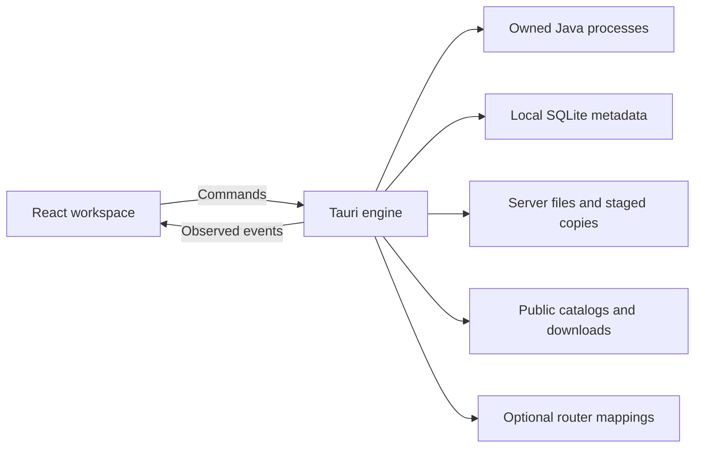

# Architecture

TCHLauncher is a local Windows desktop manager for Minecraft Java servers.
React presents the workspace; a Tauri/Rust engine owns processes, file changes,
downloads and native integrations. SQLite stores launcher metadata. Minecraft
worlds, configuration and content remain ordinary files.

The desktop binary calls `tchlauncher_lib::run()` through an `rlib`. The build
does not request C-compatible `staticlib` or `cdylib` outputs; there is no mobile
or foreign-language consumer in the current Windows scope.
See [Rust library formats](https://doc.rust-lang.org/reference/linkage.html) and
[Tauri desktop entry points](https://v2.tauri.app/start/project-structure/).

This document describes the current design. [The roadmap](NEXT_TODOS.md) records
acceptance evidence and remaining work. Historical iteration notes belong under
[development notes](docs/development-notes/), not in the current architecture.

## Boundaries and ownership

- [App.tsx](src/App.tsx) coordinates navigation and observed state.
  [api.ts](src/api.ts) defines frontend command/event types.
- [lib.rs](src-tauri/src/lib.rs) registers commands and owns `Engine`, operation
  reservations, active jobs and shutdown admission. Commands validate inputs
  before delegating blocking work.
- An operation reservation prevents a server from starting during a conflicting
  file change. Guards remain held until the native operation ends, including
  cancellation and recovery. Frontend disabled controls are supplementary.
- A hidden window or another workspace section does not terminate native work.
  No cloud service or account is required to run local servers.

## Data and storage

[storage.rs](src-tauri/src/storage.rs) owns SQLite migrations and registered
servers, backups and settings. Internal server IDs are UUIDs, independent of names.
The library contains `database/tchlauncher.sqlite`, managed `servers/<uuid>`,
`runtimes`, `backups/<uuid>` and caches. Imported servers can instead reference an
explicitly selected external directory.
Display-name changes update only the SQLite name through a validated command;
IDs, directories and Minecraft MOTD remain unchanged. The UI applies the returned
name before refreshing the library, preserving acknowledgement after read failure.

`server.properties`, `eula.txt`, access JSON files, worlds, mods, plugins and logs
retain Minecraft formats. A storage target is a warning threshold, not a disk
quota. Managed Java does not replace system Java.

Language, theme, typography and motion preferences use local browser storage.
The frontend sends the current ES/EN language to [app_menu.rs](src-tauri/src/app_menu.rs)
at startup and on changes. That module owns the tray and updates its existing menu
labels through a typed native command; it does not duplicate preference storage.
Native settings such as schedules, OS startup and recorded consent use their
backend stores. Draft UI values are distinct from acknowledged native changes.
Library relocation is not implemented.

[locale.ts](src/locale.ts) owns application-copy lookup. The general English
catalog includes reviewed native messages from
[native-en.ts](src/locales/native-en.ts). Stored `Error: ` results use that native
catalog and its existing compiled patterns for their body, preventing general UI
labels from partially translating an unknown diagnostic or path. Exact complete
message translations take precedence. Unknown details are kept verbatim; console
rows render raw Minecraft text. Router diagnostics and Minecraft status-query
errors use this same catalog; protocol responses remain unchanged. Native-copy
coverage remains in progress. Existing native translations should move into that
catalog when their module is reviewed, alongside new entries.
The content audit sends `logNotes` as separate application-owned messages. The
frontend translates each note before joining them for display, so Fabric load-list
and dependency-review copy remains localizable without parsing combined prose.
`nativeMessageDetails` marks which arguments in fourteen reviewed templates contain
application errors. `translatedMessage` translates only those nested arguments,
with a depth limit of eight. Names, paths, cleanup destination lists and installer
output remain data. General `t()` lookup and explicitly supplied arguments retain
their existing behavior.

The stop-and-exit command returns per-server failures with an explicit cause:
stop error, timeout or backup error. It exits only when the failure list is empty;
other outcomes release operation guards and permit a retry. The close dialog
renders each server name as data and localizes its failure separately. Command
infrastructure errors still reject with a string.

## Frontend reads and actions

[serverRead.ts](src/serverRead.ts) separates unread, loaded, loading and failed
observations. Selection and request revisions reject obsolete replies. Failed
reads retain labeled previous data. `useServerRead` owns visible read errors;
its public refresh callback currently absorbs the rejection after publication.
Property and backup hooks have their own revision/dirty-draft handling.
The property draft keeps a copied read/acknowledged baseline for explicit discard.
Discard restores that baseline and invalidates obsolete reads while retaining
read errors; it does not write Minecraft files. Settings also reset unsaved memory
and storage targets to the selected server's last received metadata.
The same saved-value snapshot lets settings validate changed numeric fields
without rejecting unchanged imported values. Bounds come from the rendered field
metadata. Save reveals an invalid field hidden by search and requests localized
browser validity feedback; native validation remains authoritative.

[acknowledgedAction.ts](src/acknowledgedAction.ts) separates a successful native
mutation from a failed follow-up read. Relevant workflows retain acknowledgement
and offer a read-only retry instead of repeating installation or publication.
Component operation owners prevent overlapping submissions and late updates.

Deferred sections load through [DeferredPanel.tsx](src/DeferredPanel.tsx). Console updates
are batched and bounded; catalog/icon reads and metrics use appropriate visibility
scheduling. Initial bundle size is not evidence of native RAM or frame time.

## Installation and Java

| Responsibility | Owner |
| --- | --- |
| Official Minecraft metadata and server installation | [install.rs](src-tauri/src/install.rs) |
| Paper release catalog | [paper_catalog.rs](src-tauri/src/paper_catalog.rs) |
| Fabric and NeoForge strategies | [fabric.rs](src-tauri/src/fabric.rs), [neoforge.rs](src-tauri/src/neoforge.rs) |
| Loader artifact identities | [loader_identity.rs](src-tauri/src/loader_identity.rs), [neoforge_release.rs](src-tauri/src/neoforge_release.rs) |
| Managed/custom Java verification | [runtime.rs](src-tauri/src/runtime.rs) |
| JVM arguments and memory settings | [jvm.rs](src-tauri/src/jvm.rs) |
| Explicit, remembered EULA consent | [eula.rs](src-tauri/src/eula.rs) |

Java selection follows the version/platform requirements. Temurin downloads can
fall back from a matching JRE to JDK. Verification runs the executable with a
bounded hidden process. Runtime publication uses staging and shared-path locks;
reinstallation uses another generation instead of replacing another server's
running executable. Custom runtimes are inspected before selection.

[download.rs](src-tauri/src/download.rs) uses HTTPS, bounded responses, source
hashes where available, unique partial files and validated publication. Streaming
computes only the requested digest; absent expected hashes initialize no hasher. Transient
network failures get at most three attempts. Permanent failures and hash mismatches
are not retried automatically. Cancellation interrupts requests, body reads and
retry waits; guarded publication is not cancellable. HTTP Range resume is not
implemented. Each task has a server ID, task ID, kind, stage and measured transfer
fields; unavailable totals remain unknown. Failed tasks retain their last attempt.

## Java process lifecycle

[process.rs](src-tauri/src/process.rs) owns each child, stdin, output readers,
process/session identity and state. The UI follows native state events rather
than treating a button click as successful startup. Readiness requires recognized
server-thread output in [log.rs](src-tauri/src/log.rs), not arbitrary completion
text. [startup.rs](src-tauri/src/startup.rs) exposes observed preparation phases.

Stop sends Minecraft's graceful command. Forced shutdown requires the explicit
confirmation path, a stopping process and its exact session token. A stale token
cannot kill a replacement process. Restart waits for a clean stop before starting
again. Unexpected exits retain diagnostic evidence and terminal state.

[shutdown.rs](src-tauri/src/shutdown.rs) requests all selected graceful stops
before waiting against a shared deadline. Failures are reported together; it does
not silently force-kill children. Close can keep the engine in the tray, stop owned
servers or cancel. New operations are restricted while shutdown is admitted.
Configured stop backups require a clean, previously running session; forced exits
and failed startup do not claim a successful save.

## Worlds, imports and recovery

- [world.rs](src-tauri/src/world.rs) discovers worlds through bounded `level.dat`
  inspection and owns duplicate, export, activation and deletion. Active worlds
  cannot be deleted. Destructive changes use confirmations and safety copies.
- [world_import.rs](src-tauri/src/world_import.rs) reviews and rereads selected
  world families. Paper's separate Nether/End folders belong to the main world;
  split families require a Paper destination. No automatic cross-engine world
  conversion is claimed.
- [world_publication.rs](src-tauri/src/world_publication.rs) stages family copies
  and uses trusted SQLite plans, ownership markers and fingerprints to recover
  interrupted publication. Conflicting or externally changed files are retained
  for review. Recovery does not delete visible world folders to resolve a conflict.
- [import_identity.rs](src-tauri/src/import_identity.rs) and
  [import_preview.rs](src-tauri/src/import_preview.rs) inspect existing servers
  without executing arbitrary launch scripts. Copying preserves the source;
  in-place management explicitly affects the original directory.
- [instance_publication.rs](src-tauri/src/instance_publication.rs) coordinates
  publication of a registered instance and its staged files.

Startup attempts durable recovery before conflicting work. Unavailable external
publication destinations remain pending. Termination before a durable world plan
exists can leave hidden staging folders; power-loss recovery is not established.
External editors can invalidate a reviewed filesystem state and must be stopped
before copying or restoring.

[world_bundle.rs](src-tauri/src/world_bundle.rs) streams combined world/content
ZIP exports with hashes and a restoration guide. Exports preserve disabled content
and reject links, redirected paths and destinations within the source server.
They include selected world/player/configuration data, but are not full backups.
For Paper, excluding configuration exports only top-level `.jar` and
`.jar.disabled` plugin files; plugin data directories are not traversed. Including
configuration retains plugin folders plus `config` and `defaultconfigs`.
World files and the existing Fabric/NeoForge content selection are unchanged.

## Configuration, backups and updates

[properties.rs](src-tauri/src/properties.rs) parses and validates Minecraft
properties. [server_settings.rs](src-tauri/src/server_settings.rs) coordinates
combined properties, memory and storage-target publication. The frontend keeps
unsaved drafts and distinguishes conflicts from successful saves.

[capacity.ts](src/capacity.ts) also provides advisory starting heaps for creation,
server settings and modpack import. It uses 2 GiB for Vanilla/Paper or 4 GiB for
modded servers, plus 512 MiB per ten configured slots above ten, capped at 8 GiB.
The suggestion leaves at least 2 GiB or 25% of physical RAM for other work. It is
omitted when that baseline cannot fit, memory is unknown or slots exceed 100.
These are local heuristics, not measured requirements; saved JVM limits are unchanged.

[backup.rs](src-tauri/src/backup.rs) owns full server copies, metadata snapshots,
restore validation and recovery. Restore stages files and coordinates the directory
change with SQLite; a damaged snapshot cannot become an arbitrary path. Retention
lives in [backup_retention.rs](src-tauri/src/backup_retention.rs); clean-stop copies
are coordinated by [stop_backup.rs](src-tauri/src/stop_backup.rs).

[minecraft_update.rs](src-tauri/src/minecraft_update.rs) and
[loader_update.rs](src-tauri/src/loader_update.rs) review compatibility, Java and
content before replacement. Safety copies precede changes and support rollback.
A failed metadata refresh does not discard an acknowledged update or authorize
an obsolete replacement plan. Cross-engine conversion and every content migration
are not established by the existing Vanilla upgrade scenario.

## Mods, plugins and packs

[content.rs](src-tauri/src/content.rs) integrates public Modrinth discovery,
version selection and dependency plans. Paper plugins remain distinct from mods;
client resource packs/shaders are not installed as server mods. Plans identify
required dependencies, optional entries and declared conflicts before installation.

[content_storage.rs](src-tauri/src/content_storage.rs) owns staged content writes,
receipts, hashes, enable/disable, removal and recovery. Bulk changes use safety
copies. [content_diagnostics.rs](src-tauri/src/content_diagnostics.rs) relates
inventory and observed log evidence without equating a present JAR with gameplay.

[fabric_presence.rs](src-tauri/src/fabric_presence.rs) inspects main and nested
metadata with shared traversal budgets. [fabric_version.rs](src-tauri/src/fabric_version.rs)
compares recognized Fabric predicates. Incomplete evidence, dependency overrides
and unknown syntax suppress negative conclusions. This is not Fabric's global
candidate solver and does not prove Java/loader predicates or gameplay.
The inventory separately compares main Fabric JAR Minecraft requirements with
configured numeric stable releases. Unknown predicates, experimental version IDs,
client-only JARs and dependency overrides do not produce a mismatch warning.
This is an advisory comparison with launcher configuration, not a boot check.

[modpack.rs](src-tauri/src/modpack.rs) and [pack_install.rs](src-tauri/src/pack_install.rs)
validate `.mrpack` selections, allowed download origins, hashes, server overrides
and protected settings. Client/optional files follow the reviewed selection.
Completed installation remains acknowledged if the library refresh fails.
Complex third-party modpacks still require real native/client verification.

## Player identity and access

[players.rs](src-tauri/src/players.rs) reads Minecraft inventories and tracks
session-observed login UUIDs. Pending observations are bounded and expire; ambiguous
or unobserved identities remain unknown. Same-name accounts are never merged by
name. [skin.rs](src-tauri/src/skin.rs) retrieves validated Mojang textures by UUID,
crops the head/hat and caches bounded images. Missing evidence gets a neutral head.

[access_lists.rs](src-tauri/src/access_lists.rs) owns stopped-server whitelist/OP/
ban-file mutations. Its bounded writer preserves other records and unknown fields,
retains original-byte safety copies, compares the current file before publication
and rejects redirected files. Known-player OP grants require an explicit review;
an existing operator UUID is not overwritten. Permission edits check their expected
previous values. Live commands use Minecraft's command path where supported.

[authentication.rs](src-tauri/src/authentication.rs) reports direct/proxy/offline
configuration evidence. Reading settings or displaying a skin does not authenticate
a Microsoft account or migrate player inventories between UUIDs.

## Metrics, networking and automation

| Area | Owners and limits |
| --- | --- |
| CPU, resident RAM and process I/O | [process_metrics.rs](src-tauri/src/process_metrics.rs); process measurements are distinct from Java heap |
| Heap and memory reports | [heap.rs](src-tauri/src/heap.rs), [memory_report.rs](src-tauri/src/memory_report.rs); no forced GC |
| Minecraft status and Paper TPS | [server_ping.rs](src-tauri/src/server_ping.rs), [ticks.rs](src-tauri/src/ticks.rs); unavailable observations stay unknown |
| Cached directory/volume readings | [storage_usage.rs](src-tauri/src/storage_usage.rs); targets do not enforce quotas |
| LAN and explicit public-address lookup | [network.rs](src-tauri/src/network.rs); local probing does not verify Internet reachability |
| Temporary router access | [upnp.rs](src-tauri/src/upnp.rs), [natpmp_manager.rs](src-tauri/src/natpmp_manager.rs), [natpmp.rs](src-tauri/src/natpmp.rs) |
| Local schedules and crash restart | [scheduler.rs](src-tauri/src/scheduler.rs), [crash_restart.rs](src-tauri/src/crash_restart.rs) |
| Explicit OS/session startup preferences | [autostart.rs](src-tauri/src/autostart.rs) |

Router discovery can run automatically; mapping creation remains explicit.
Ownership, expected address/port and persisted cleanup state govern renewal/removal.
A router acknowledgement neither opens the Windows firewall nor proves outside
connectivity. No Bore or mandatory tunnel provider is present. Physical router,
CGNAT and actual remote-client behavior need separate evidence.

## Diagnostics and acceptance

[crash_diagnostics.rs](src-tauri/src/crash_diagnostics.rs) retains bounded exit/log
observations and uses local rules to propose review actions. Recent content file
dates are evidence, not proof of the crash cause. General action errors, task
failures and crash reports preserve the original technical reason.

[app_log.rs](src-tauri/src/app_log.rs) rotates structured launcher events without
copying arbitrary Minecraft chat, commands or credentials. Settings opens the local
log folder through a validated native command. Java mods/plugins are executable
third-party code; see [SECURITY.md](SECURITY.md) for the trust boundary.

Windows distribution remains an unsigned preview. Current maintainer feedback
and scenario evidence are recorded in the roadmap.
Native layout/keyboard/accessibility, clean install/upgrade/uninstall, real client
permissions/gameplay and physical-router cases remain explicit acceptance gates.
Current test scope and commands belong in [README.md](README.md) and the
[integration guide](src-tauri/tests/fixtures/README.md). Historical test counts are
not current regression coverage. Linux and client launching remain deferred.
